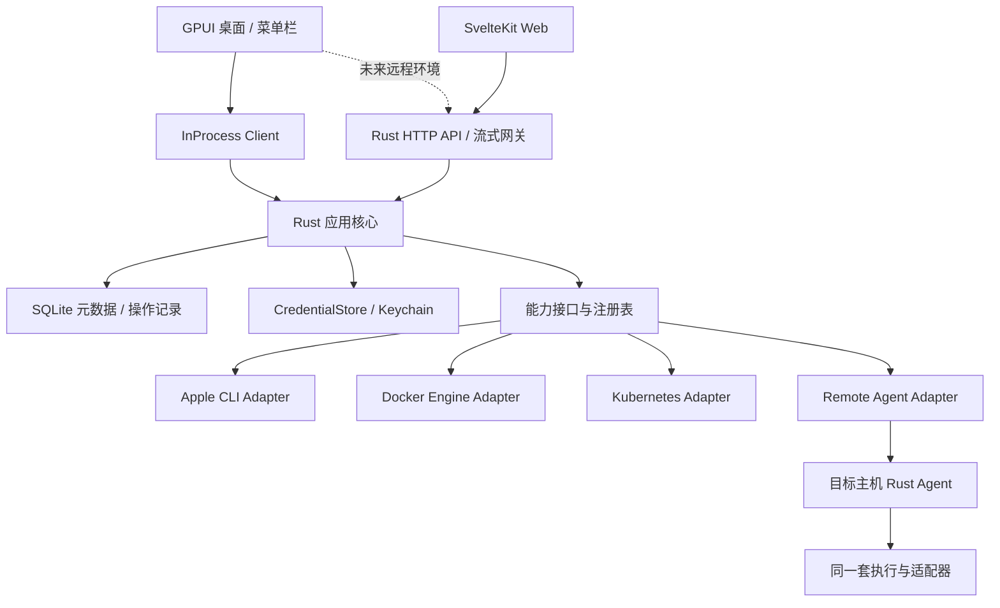

# ContainerHub 产品与技术计划

> 2026-10-21 · 提案 v1 · Rust + GPUI 原生桌面优先
>
> 实现进度（2026-10-22）：已推进至增量 5，在基础拉取/创建/删除/统计和公共 core / management / runtime 模块、Node SDK 上，补入镜像详情/删除与日志导出，复用既有 Agent 加密控制路径。当前验证与剩余差距见 [DEVELOPMENT.md](../docs/DEVELOPMENT.md)，实际模块边界见 [ARCHITECTURE.md](../docs/ARCHITECTURE.md)。运行时升级至 1.6.0 后，用户决定稍后处理系统磁盘授权；本轮会话的 launchctl 服务访问仍受阻。下文的 1.2.2 调研记录保留为原始快照。
>
> 核查与决策更新（2026-10-22）：[第一阶段核查](PHASE-ONE-AUDIT.md) 确认 M1 未完成。用户确定 Agent 首版同时支持直连与公网/NAT 中继，并采用先来先绑定；[远程身份方案](REMOTE-AGENT.md) 定义所有者根公钥、各端设备授权与密钥同步边界，替代一次性邀请作为强制首次配对条件。身份、原子绑定、直连/中继和 Native/WASM 互操作已实现并在本机隔离环境通过验证，参见 [远程开发记录](../docs/REMOTE-DEVELOPMENT.md)。正式应用证明、真实公网/NAT、完整 Web 与同步仍未完成。
>
> 本文是实现计划。原型内的容器、用量、日志与任务均为示例，不能当作实现或性能证明。

当前实现更新（2026-10-23，增量 17）：已实看原生 Demo 的亮/暗色窗口，修复列表行宽、列对齐、操作分组与组件主题；六组尺寸/主题的 Metal 像素场景纳入验收。创建后启动与持久化检查点继续使用公共流程。本机服务启动与结果核对已加入共享执行模块；任务归档、真实 Apple 新增功能与公网验收仍未完成，见 [增量 17](../docs/INCREMENT-17.md) 与 [增量 16](../docs/INCREMENT-16.md)。

## 1. 产品目标与范围

把本机 Apple container 的日常操作集中到一个可靠的原生工作台：看清当前状态，一步启停，快速定位失败，完整管理与容器相关的资源。长期对标 Portainer 的资源管理、部署、多环境、团队权限和治理能力。

首要用户是管理本机开发环境的开发者，随后是管理多台开发机、小型服务器和 Kubernetes 集群的个人及团队。产品暂用仓库名 **ContainerHub**。

首发约束：

- Apple silicon + macOS 26；安装好的 Apple container 由用户控制。发现未安装、服务未运行、版本不兼容时给出具体恢复路径。
- 无需登录或云账户，本机功能可离线使用；远程镜像操作按网络状态显示明确错误。
- 管理当前用户可见的全部资源，包括通过 CLI 或其他工具创建的资源；不能只展示 ContainerHub 自己创建的容器。
- 从默认列表启动或停止一个容器只需一次点击；查看日志不超过两次点击；常用操作支持键盘和菜单栏入口。
- 当前开发增量的生命周期读写验证目标为 1.6.0；1.2.2 保留解析 fixture，尚未验证写入。原调研中的版本事实见 §2；没有执行过的版本不能标为「已验证兼容」。
- 对标的是任务覆盖率与管理能力，不复制 Portainer 的布局、品牌或代码。

「完整管理」定义为：已验证运行时公开、稳定的管理能力有 UI 入口、反馈与错误恢复。实验功能、运行时不支持的能力及尚未接入的版本必须单列，不能用一个可执行任意命令的输入框代替完成度。

## 2. 调研结论及其影响

| 已核查事实 | 产品和架构决定 |
| --- | --- |
| Apple 官方支持 Apple silicon / macOS 26；基于轻量 VM 运行 OCI 容器 | 首发平台明确；指标区分容器用量、配置上限和宿主机总量 |
| 本机 CLI 为 1.2.2，服务正在运行；上游发布为 1.6.0 | 能力由版本、help 和只读探测共同确定；不擅自更新运行时 |
| 1.6.0 增加 commit；build / builder 转为 CLI 插件 | 插件缺失是独立状态；发现与诊断不能只检查主二进制 |
| list、stats、system status 等支持 JSON；inspect 本身输出 JSON | 使用结构化数据；不以表格列宽或本地化文案解析资源 |
| 当前核查的命令入口未提供通用 restart / pause / events / Compose | 重启编排 stop → 确认停止 → start；轮询同步；不伪造暂停或原生 Compose 支持 |
| 已有 machine 和实验性 k8s 插件 | machine 纳入本机完整管理；实验性本地集群管理放入 Kubernetes 阶段 |
| GPUI 是 Rust GPU UI 框架；GPUI Component 当前文档已迁往 GPUI Kit | 优先验证 GPUI + GPUI Kit 兼容组合，锁定版本；关键 UI 由自有组件层隔离依赖变化 |
| Portainer 同时覆盖单机资源、Stacks、Kubernetes、环境与权限 | 建立分阶段对标矩阵；团队治理作为独立阶段交付 |

来源和只读核查范围见 [RESEARCH.md](RESEARCH.md)。上述结论是 2026-10-21 的快照；每次实现或发布前重新确认目标版本。

## 3. Portainer 对标矩阵

阶段：**A** = 快捷管理 0.1；**B** = Apple 本机管理 1.0；**D** = Docker；**K** = Kubernetes；**R** = 远程 Agent + Web；**T** = 团队与治理。

| 能力领域 | ContainerHub 范围 | 阶段 / 验收口径 |
| --- | --- | --- |
| 容器生命周期 | 全量发现、筛选、排序、启停、重启、删除、批量操作、inspect | A；逐资源结果与实际状态一致 |
| 容器创建与重建 | 镜像、命令、端口、挂载、环境、CPU/内存；复制配置；不可热改字段明确重建 | A 基础创建；B 完整表单和差异预览 |
| 排障与观测 | 有界日志、boot log、终端、资源统计、操作历史、错误恢复 | A 日志与统计；B PTY 与完整诊断 |
| 镜像 | 拉取、删除、inspect、标记、推送、导入/导出、commit（按能力） | A 拉取/删除；B 完整管理 |
| 构建 | 上下文、Dockerfile/Containerfile、参数、阶段、缓存、取消、构建器管理 | B；兼容内置命令和独立插件 |
| 网络 | 列表、详情、创建、删除、DNS/端口、连接资源关系 | B；变更支持与否由适配器决定 |
| 存储卷 | 列表、创建、使用关系、删除、空间诊断、受控备份恢复 | B；删除前重新核验引用，备份说明一致性要求 |
| 文件 | 按路径复制、文件系统导出；完整浏览器后续增量 | B；文件大小、覆盖、权限与路径错误可恢复 |
| 注册表 | 登录/退出、凭据状态、私有仓库拉取/推送 | B；复用运行时凭据机制；不将密码写入 argv/数据库/日志 |
| Host / 运行时 | 服务启停、版本、磁盘、DNS、系统配置、kernel、builder、machine | A 健康和启停；B 全部稳定入口 |
| Stacks / 模板 | Apple 项目分组与启动模板；Docker Compose 部署；K8s manifest / Helm | B 分组与模板；D Compose；K manifest/Helm，格式分别保存 |
| 多环境 | 本机运行时切换、Docker context、K8s context/namespace、远程主机 | D/K/R；每个操作绑定环境身份 |
| 更新与交付 | 镜像 digest 差异提示、重建预览、Git 来源部署、回滚记录 | B 手动重建；D/K 部署；T Git 自动交付策略 |
| 团队与权限 | 用户、团队、环境角色、资源访问、审计、认证集成 | T；服务端与 Agent 均执行授权 |
| 远程与边缘 | 注册、心跳、能力协商、断线恢复、吊销、升级 | R；默认主动出站连接，不要求开放宿主 Docker 端口 |
| 配置与 Secrets | 配置来源、凭据引用、K8s ConfigMap/Secret；授权后临时查看 | B 本机引用；K 资源；T 分权与审计 |
| 治理 | 配额、策略、模板权限、审计导出、维护窗口、备份 | T；逐条验收，避免以「Portainer parity」笼统宣称完成 |
| Docker Swarm / Podman | 保留适配能力，尚不承诺首轮支持 | 后续候选；先完成用户指定的 Apple、Docker、K8s |

Portainer 对标依据为其 [Docker 管理目录](https://docs.portainer.io/user/docker)、[容器工作流](https://docs.portainer.io/user/docker/containers)、[Kubernetes 管理目录](https://docs.portainer.io/user/kubernetes) 与 [角色说明](https://docs.portainer.io/admin/user/roles)。其中细粒度角色能力在其文档中属于 Business Edition；本计划不把所有能力描述为 CE 默认功能。

## 4. Apple 功能清单与边界

### 4.1 快捷管理 0.1 必须形成闭环

- 启动检测：平台、CLI 路径与版本、服务健康、能力快照；未安装时提供安装指引，启动服务是显式动作。
- 列表：包含已停止资源；搜索名称/镜像/标签；状态筛选；稳定排序；手动刷新；外部 CLI 变更自动同步。
- 行操作：启动、优雅停止、重启、更多；任务进行中只禁用同资源冲突操作。删除展示影响并确认。
- 批量操作：冻结所选 ID 集合，展示实际数量；并发限制与逐项结果；部分失败可只重试失败项。
- 详情：资源身份、运行状态、镜像、CPU/内存配置、端口、挂载和 inspect；敏感字段默认遮蔽。
- 日志：尾部读取、跟随/暂停、搜索、复制选中、导出、错误提示；默认限制行数和缓存大小。
- 指标：有界采样；明确时间戳、来源和未知值；断线保留最后值但标陈旧，不把未知填成 0。
- 新建：本地或远程镜像、名称、启动命令、资源、端口、挂载、环境变量；校验后创建，可选择立即启动。
- 镜像：列表、拉取进度、取消请求、inspect、删除前引用检查。
- 任务中心：状态、耗时、阶段、错误和重试入口；「已提交」不等于「已完成」。

### 4.2 本机管理 1.0 补齐

1. **创建与重建**：完整映射已探测的稳定 create/run 参数；高级字段可折叠，危险能力默认关闭。重建先预检镜像与配置，再展示停机、端口、数据影响；保留可恢复配置和旧容器直至切换验证，名字/端口冲突必须纳入步骤。
2. **镜像与构建**：tag/push/save/load、构建上下文和忽略规则、Dockerfile 编辑、构建日志；取消后对运行时查询结果，不承诺杀掉 CLI 就能停止后端构建。commit/clean 为探测到才展示的增强项。
3. **网络与存储**：资源关系图、孤立资源预览、逐项清理；不用无差别 prune 代替用户选中的删除。卷备份需停止写入或应用一致性钩子；rootfs export 不等于持久卷备份。
4. **PTY 与文件**：交互式 exec、尺寸同步、Ctrl-C、UTF-8、粘贴、断线与退出状态；文件复制支持覆盖确认和错误恢复。不能直接复用 Zed 中未经许可审查的终端代码。
5. **系统**：服务、builder、machine 的完整生命周期；machine 配置修改标明重启生效；DNS、kernel、property 的读写按实际 help/source 确认。需要提权时用窄范围授权，不让整个 GUI 常驻 root。
6. **模板与项目**：项目是 app 元数据/可选标签分组，可保存启动模板、依赖顺序、端口与卷引用；不声称与 Docker Compose 等价。退出 GUI 后不承诺仍执行应用层重启策略。
7. **菜单栏与设置**：收藏容器、快捷启停、任务提示；窗口关闭与应用退出行为清晰。退出应用不会停止正在运行的容器。
8. **诊断与分发**：脱敏诊断包、版本/插件兼容表、签名、公证、更新与恢复说明。

### 4.3 明确不伪造的能力

- 没有健康探针数据时显示「未配置/不可用」，不把 Running 说成 Healthy。
- 没有原生事件流时，历史展示「应用操作」和「观察到的状态变化」；轮询无法保证捕获每个短暂事件。
- 没有暂停、热更新资源或 restart policy 时，不显示可用开关；后续能力由真实运行时决定。
- Apple 本地 k8s 插件支持属于 K 阶段的实验入口；B 完成仍需标明这一例外。
- 本机当前发现的版本存在后续安全修复版本；显示更新建议与维护影响，更新由用户发起，不在启动时自动停服务。

## 5. 架构

### 5.1 边界与复用



首版核心作为库在桌面进程内运行，不引入本地 TCP 服务、用户体系或一套空的微服务。依赖注入 `ManagementClient`，使 GPUI 不依赖 CLI、HTTP 或数据库细节。远程阶段再增加可部署二进制；不同进程实例不得同时写同一份操作数据库而没有租约/单实例保护。

### 5.2 建议仓库结构

```text
apps/
  desktop/                    # GPUI 入口、窗口、macOS 集成
  server/                     # R 阶段：HTTP API、认证与流式会话
  agent/                      # R 阶段：主机注册、执行与心跳
  web/                        # R 阶段：SvelteKit
crates/
  domain/                     # ID、资源类型、能力、命令与错误
  core/                       # 用例、任务、并发、重试与状态同步
  providers/apple/            # CLI 发现、版本配置、解析与 PTY
  providers/docker/           # D 阶段：Engine API / Compose
  providers/kubernetes/       # K 阶段：工作负载与 Watch
  infrastructure/             # SQLite、Keychain、进程、脱敏日志
  ui/                         # GPUI 主题、组件与页面
  protocol/                   # R 阶段前抽出版本化传输 DTO
  test-support/               # 模拟适配器、脱敏 fixtures
packages/
  client-ts/                  # R 阶段：生成的 Web API client
  design-tokens/              # UI token 单一来源
tests/fixtures/apple/<version>/
.agents/                      # 当前方案、设计与评审材料
```

初期只创建已用到的 crate；可先把 domain/core 合在一个 crate 的不同模块，边界稳定后拆分。路径是架构目标，不要求先生成所有空目录。

### 5.3 领域模型

| 类型 | 必要字段与语义 |
| --- | --- |
| `Environment` | 稳定 ID、名称、平台、连接方式、身份指纹、能力快照；Apple 用户服务不能等价为整机所有用户 |
| `ResourceKey` | environment ID + provider kind + 原生 ID + 可选 namespace；不能仅靠名称做全局键 |
| `Capability` | supported / unsupported / degraded / experimental + 原因 + 限制 + 来源；同时支持动作和参数粒度 |
| `ContainerSnapshot` | 观察状态、配置、版本、采样时间、来源；保留 provider 扩展字段 |
| `Workload` | Container / ComposeProject / Deployment / StatefulSet / Job 等不同变体；共享元信息，保留各自操作 |
| `Operation` | ID、request ID、环境、资源集合、动作、阶段、逐项结果、可重试性、时间和错误 |
| `Error` | NotInstalled / Unavailable / PermissionDenied / Unsupported / Conflict / NotFound / Timeout / AuthRequired / UnknownOutcome 等 |
| `CredentialRef` | 指向系统凭据存储；普通查询与审计仅返回引用或遮蔽状态 |
| `Observation` | 快照和流均含单调序号/版本及时间；旧响应不得覆盖新环境或新状态 |

按能力拆接口：`InventoryProvider`、`ContainerLifecycle`、`LogProvider`、`ExecProvider`、`ImageProvider`、`BuildProvider`、`NetworkProvider`、`VolumeProvider`、`HostProvider`、`WorkloadProvider`。使用组合与默认 Unsupported，避免一个包含所有后端功能的巨大 trait。

Kubernetes 删除 Pod 会触发控制器重建，不能映射为普通「停止容器」。其 UI 使用副本数、滚动重启、暂停发布、Job 和 Rollout 状态。镜像来自仓库、卷使用 PVC，不能强行套 Docker 本地镜像/volume 模型。

### 5.4 Apple 适配策略

- 发现签名安装路径、Homebrew 路径和用户显式选择的绝对路径；校验实际二进制身份，不在可写当前目录搜索可执行文件。Finder 启动时不依赖交互 shell PATH。
- 使用 `tokio::process::Command` 和独立 argv；禁止拼接 shell 命令。固定 locale、受控环境变量、超时、进程组和 stdout/stderr 上限。
- JSON DTO 只声明需要的字段，保留未知字段和原始枚举值；缺少必需字段时报出兼容错误，不能解析成空列表。
- 首选公开 CLI；不直接读取/改写 Apple 内部数据库，不实现私有 XPC 协议。未来仅在性能或缺失能力有实测证据时，评估隔离的 Swift 公共 API bridge。
- `logs` 使用独立子进程流；`exec` 使用 PTY；结束订阅回收对应客户端进程，但不能把取消监听说成取消容器进程。
- 资源列表前台目标每 2 秒刷新、后台每 10 秒；资源统计只采样可见/订阅对象。服务离线指数退避（上限 30 秒），窗口休眠降低频率；操作后立即 reconcile。参数在原型后实测调整。
- 每环境限制子进程总数、每资源串行写操作；避免每行独立 `inspect` / `stats` 产生进程风暴。
- 首次只读发现不得启动服务、builder、machine 或集群；恢复入口由用户选择。

### 5.5 操作可靠性

状态机：`Queued → Running → Reconciling → Succeeded / Failed / PartiallySucceeded / Cancelled / UnknownOutcome`。取消请求首先进入 `CancelRequested`，只有确定未继续执行才标为 Cancelled。

1. 入队时固定环境身份和目标 ID，先落操作记录；同资源冲突操作串行，批量默认最多 4 并发。
2. 「启动」可通过读取已运行状态实现幂等；create/delete/rebuild 超时后先对账，不盲目重试。UI 不因进程退出码 0 就立即显示最终资源状态。
3. 重启是两段操作；停止成功但启动失败必须保留「已停止 / 启动失败」及重试启动入口。`--rm` 资源停止可能被删除，重启前单独处理或拒绝并解释。
4. 新建先完成名称、端口、路径、容量和字段校验；失败时说明资源是否已创建、镜像是否仍在拉取；幂等键及已知 ID 用于重启后对账。
5. 删除和清理再次查询依赖；目标变化则重新展示影响，不用列表缓存直接执行。停止本身不删除卷；批量删除默认不附带卷或镜像。
6. UI 退出或崩溃后，下次启动恢复未终结操作并查询运行时；无法确定远端结果时标 UnknownOutcome，提供查询结果入口。
7. 日志、PTY、任务事件均有背压和有界缓冲；丢弃/截断显式提示。高流量日志不能堵塞 GPUI 渲染线程。
8. 切换环境取消旧订阅并校验 generation，避免旧机器的响应落入新页面；异步结果用不可变快照更新视图，避免 GPUI Entity 重入。

### 5.6 存储、凭据和远程路线

本机 SQLite（WAL + schema migration）只存环境定义、分组、收藏、布局、操作和审计摘要。运行时仍是资源真相来源；数据库丢失不能导致容器失联。敏感环境值/registry token 使用 Keychain 或运行时已有凭据存储，数据库只留引用；表单内临时输入不持久化、不进入调试日志。设置、资源快照、日志导出分别保留与清理，默认不长期保存原始容器日志。

远程阶段的连接路径（2026-10-22 绑定规则更新，细节见 [REMOTE-AGENT.md](REMOTE-AGENT.md)）：

- 桌面仍保留本机离线模式。Agent 首版同时支持认证直连与主动出站的公网/NAT 中继；两条路径共用同一绑定和授权。Web 不持有 Docker socket 或宿主路径权限。
- Rust Server 提供版本化元数据/同步 API 和密文转发，控制端至 Agent 的命令与流采用端到端加密；Web 不需要把控制私钥交给网关。生成 TypeScript client，Rust 核心不使用网页组件类型。
- 未绑定 Agent 将第一个完成验证并原子提交的所有者根公钥持久化；控制端同时固定 Agent 身份。后续仅接受该所有者授权的设备。首次认领不强制邀请码；官方客户端资格仍不能证明它属于预期主人，首次信任限制见远程方案。
- Native/Web 使用独立设备密钥与所有者签名授权；同步加密资料、Agent 身份和授权记录。根私钥默认不复制到 Web，会话密钥不持久化同步。协议选型需验证浏览器兼容性，不能把自动 mTLS 客户端证书安装作为 Web 前提。
- 命令带 operation ID、幂等键、目标身份、授权范围、截止时间和审计信息。断线前后对账，过期命令不执行；有序事件带游标，游标过期回全量快照。
- Server 执行账户及同步访问控制，Agent 独立验证所有者授权、设备持钥、授权有效期与操作范围。账户登录和 Relay 路由不授予 Agent 控制权；终端、文件写入、Secrets 读取使用独立权限。
- macOS Agent 按目标用户运行，不能用 root LaunchDaemon 冒充用户 Apple container 会话；Linux Agent 的 Docker socket 权限按高权限能力管理。
- Server 元数据起步可用单节点 SQLite；团队部署后再评估 PostgreSQL。高可用、多副本调度与审计不可变存储不作为 R 首版隐含承诺。

### 5.7 技术候选与决策方式

| 领域 | 首选方向 | 合入前验证 |
| --- | --- | --- |
| UI | GPUI + 自有组件层，评估 GPUI Kit | 表格虚拟化、中文输入法、焦点、VoiceOver、主题、许可证、版本兼容 |
| 异步/数据 | Tokio、Serde、SQLite | 与 GPUI executor 的边界；阻塞 I/O 不落 UI 线程 |
| Docker | Engine HTTP API（评估 Rust client），Compose 调用明确安装的官方 CLI | API 版本协商、context、Unix socket/TLS、流式输出、Compose 退出码 |
| Kubernetes | Rust Kubernetes client + watch/informer | context 隔离、namespace、RBAC、watch 失效后重列举、exec 认证插件 |
| PTY | 可维护的 PTY 库 + 独立终端模型 | 许可证、resize/IME/selection、大输出、退出与断线；不复制 GPL 产品模块 |
| Web | SvelteKit + TypeScript + 共享 token | 同一用例契约；SSR 不访问本机运行时；cookie/CSRF/CSP、流式鉴权 |
| API | Axum / Rustls / OpenAPI | SSE/WS 背压、跨版本协商、代理超时、幂等与权限 |

以上是候选，不在规划阶段用未经编译验证的精确依赖组合锁死工程。选型 spike 产出 Cargo.lock、最小原生窗口与实际连接证据后定版。

## 6. 分阶段交付与验收

时间为一位熟悉 Rust 的全职工程师的粗估，包含测试与基础打包，不含外部审查等待；GPUI 终端、权限和版本兼容会影响区间。以验收结果推进，不以日期替代质量。

| 里程碑 | 工作包 | 依赖 / 交付 | 验收 |
| --- | --- | --- | --- |
| M0：技术验证，约 1 周 | GPUI/Kit 兼容、CLI JSON fixtures、生命周期/PTY 小实验、打包路径 | 当前方案；输出 ADR、兼容表与可运行最小壳 | 原生窗口中文输入正常；真实只读资源可展示；测试资源可启停；明确终端路线 |
| M1：快捷管理 0.1，约 2–3 周 | 列表、详情、启停/重启/删除、新建、日志、基础统计、镜像拉取、任务中心 | M0 | 从拉取镜像到容器运行、查看日志、停止删除完成闭环；外部变更可同步；部分失败可恢复 |
| M2：资源管理，约 2–3 周 | 镜像全流程、构建、registry、网络、卷、文件、PTY | M1 | 私有镜像/构建/卷保留/网络端口/终端真实验证；缺失插件不崩溃 |
| M3：Apple 1.0，约 2–3 周 | machine、系统/DNS/kernel、空间清理、模板分组、菜单栏、恢复/签名/公证 | M2 | 稳定功能清单全部闭环；1.2.2 与 1.6.0 分别给出运行证据；试用包可安装和重启 |
| M4：Docker，约 3–4 周 | Engine API、context、events、Compose 部署/更新/回滚、扩展资源 | M3 核心稳定 | 同一 UI 契约运行 Apple/Docker；真实 Compose 故障与更新可恢复 |
| M5：Kubernetes，约 4–6 周 | context/namespace、workload/pod、日志/exec、service/ingress、PVC、配置、manifest/Helm | M4 后端抽象校准 | kube RBAC 受限账户、watch 重连、rollout/rollback、namespace 隔离验收；Apple k8s 插件另测 |
| M6：远程 Agent + Web，约 4–6 周 | 协议、Rust Server/Agent、配对、出站连接、SvelteKit、审计与权限基础 | M4/M5 共享用例与资源身份稳定 | 至少两台真实主机；断网/重连/吊销；Web 与桌面同一操作结果；运行时凭据不出 Agent |
| M7：团队与治理，拆分估算 | OIDC、团队/RBAC、Git 部署、策略、审计导出、维护/备份、更新治理 | M6 | 权限矩阵和越权/重放测试通过；逐项记录 Portainer 对标差距 |

**建议先完成 M0–M3，再承诺扩展阶段日期。** Web 不提前阻塞原生首版；协议和环境标识在本机阶段预留。2026-10-22 增加独立的 Agent 身份/绑定/直连与中继验证工作包，可提前校准 Native/WASM 契约；它不代表 M1 或 M6 已完成，也不绕过接入远程写操作前的多环境与可靠任务基础。M7 必须再拆 ADR 与独立验收，不能把全部企业治理压进一个短迭代。

## 7. 验证策略

### 7.1 分层测试

- 单元：DTO 容错、参数构造、能力判定、状态机、过滤/排序、错误分类、路径与脱敏。
- 契约：Apple 不同版本的脱敏 JSON fixtures；所有适配器通过同一资源身份、操作结果、订阅取消契约。
- 真实集成：只用测试创建并标记的容器、网络与卷；测试结束只清理这些 ID，禁止全局 prune。分别记录运行时版本、主机系统、镜像 digest 与结果。
- 原生 UI：GPUI 交互、中文/英文 IME、焦点和快捷键、行右键目标、批量选择、日志跟随、深浅色、100%/200% 缩放、VoiceOver 和 Reduce Motion。
- 故障：服务掉线、CLI 被替换、进程超时、磁盘满、镜像认证失败、端口占用、删除竞争、应用崩溃、休眠唤醒、巨大/损坏 JSON、长日志、重启一半失败。
- 远程阶段：过期证书、错误主机身份、吊销、时钟偏差、事件游标失效、重复命令、断线未知结果、跨租户访问和终端越权。

### 7.2 必过的用户旅程

1. 未安装 → 指引 → 检测安装 → 显式启动服务 → 空状态 → 拉镜像 → 创建 → 打开映射端口。
2. 外部 CLI 创建 → 应用发现 → 查看配置 → 修改需重建字段 → 预览影响 → 执行与核验。
3. 十个测试容器批量操作，一个故意失败 → 其余继续 → 错误项可见 → 只重试失败项。
4. 查看大量日志时继续筛选容器；暂停跟随保持滚动位置；切换环境不串日志。
5. 重启 stop 成功而 start 失败 → 正确显示已停止 → 修复原因 → 重试 start。
6. 清理镜像/卷前引用变化 → 阻止错误删除；删除容器后持久卷数据仍在。
7. 关闭窗口、退出应用、重新启动 → 容器继续运行，操作状态重新对账。
8. 凭据和 Secret 出现在失败响应中 → UI/日志/诊断包按字段规则脱敏，原始运行时日志导出由用户确认范围。

### 7.3 性能目标（待测，不是承诺已达成）

参考机选定并记录芯片、内存、macOS、构建模式和运行时版本后测量：

- Release 冷启动首个可交互窗口 p95 < 1 秒；已有缓存首屏 < 500 ms；资源刷新另记，不把网络/VM 启动耗时计为 UI 阻塞。
- 点击反馈 p95 < 100 ms；生命周期命令执行和运行时完成分别计时，不承诺容器必在 1 秒内启动。
- 1,000 条 fixture 列表筛选 p95 < 100 ms；滚动目标 60 fps；这只验证渲染，不代表宿主机能同时运行 1,000 个 VM。
- 10,000 行/秒的模拟日志持续 10 分钟：缓存有上限，UI 可操作，丢弃量可见，无线性内存增长。
- 无活动任务的空闲 CPU 目标 < 1%；基础应用 RSS 目标 < 150 MiB（不含 Apple 服务和容器 VM）；按实测修订预算并解释差异。

### 7.4 发布完成条件

fmt/clippy/必要测试、目标 macOS 本地集成、安装包身份与版本、签名和 notarization、公证 stapling、干净用户首次启动、已安装应用升级、兼容表、数据迁移备份与恢复说明。CI 成功、源代码审查或 HTML 原型都不能代替 GPUI 运行与已安装应用验证。

## 8. 风险与应对

| 风险 | 处理与停止条件 |
| --- | --- |
| CLI / JSON / 插件版本变化 | 版本化 fixtures + capability discovery；必需字段不认识时限制写操作，说明升级路径 |
| 程序打包后找不到 CLI | Finder 启动测试；候选绝对路径与手动定位；无 shell PATH 假设 |
| 启停、重建、清理造成数据损失 | 影响预览、再查引用、优雅停止、数据保留默认值；不保证数据库级备份一致性 |
| 高流量日志 / 大资源列表拖慢 UI | 独立线程、虚拟化、合并事件、背压、缓存上限；先测再扩能力 |
| 原生终端/辅助功能成本高 | M0 做真实 spike；关键缺口阻塞相关发布声明，不能用静态样式替代 |
| 运行时权限太大 | 同用户执行、最小提权入口、Keychain、参数隔离；Web 无直接宿主权限 |
| 过度统一 Docker/K8s | 共享环境/资源/任务基础，保留 provider 的工作负载和专用页面 |
| 多机操作打错环境 | 常驻环境标签、环境固定在 operation、生产标识和高影响确认 |
| 分发渠道限制 | 首选 Developer ID 独立分发；Mac App Store 可行性另审，不承诺 sandbox 可直接管理任意宿主资源 |

## 9. 开始实现时的首个工作包

1. 建立 Cargo workspace、版本锁定、格式与静态检查，确认许可证边界。
2. 做 `Environment / ResourceKey / Capability / Operation` 和一个可注入的 FakeProvider。
3. 做 Apple 路径/版本/服务发现，记录脱敏 fixtures，再做只读列表与详情。
4. 在 GPUI 实现本设计的壳、表格、主题、状态条；连接只读适配器。
5. 用专用测试容器接通启停与任务状态，运行第一组真实旅程。

完成这五项后再推进镜像、新建和日志。每个里程碑交付可运行包、实际验证记录和剩余差距，不把计划中的能力展示成已实现。
