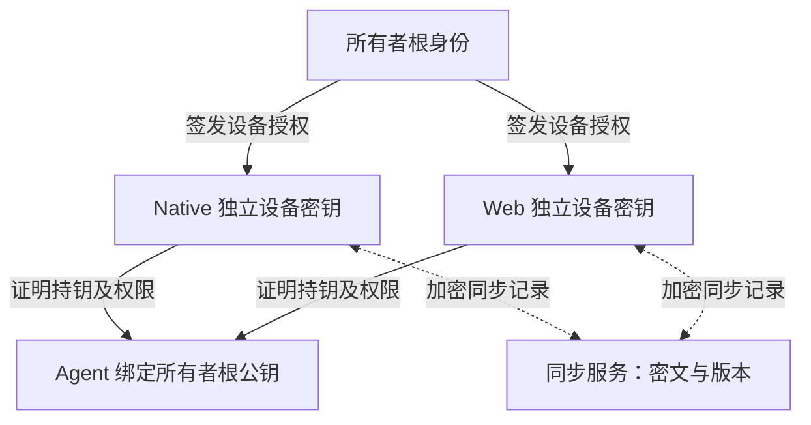

# 远程 Agent：首次绑定与跨端身份

2026-10-22。状态：**增量 5 已实现 Agent、Relay、Native 客户端、WebCrypto/WASM 协议模块及 Node 远程管理接入；完整 Web、云端密钥资料同步、正式应用证明和真实公网验收尚未完成。** 用户已确定首版同时支持直连和公网/NAT 中继，并采用先来先绑定；本文件替代 PLAN 原先要求一次性邀请的绑定方案。新增公共命令、管理权限及模块边界见 [ARCHITECTURE.md](../docs/ARCHITECTURE.md)。

实现、命令、协议编码和本轮验证范围见 [远程开发记录](../docs/REMOTE-DEVELOPMENT.md)。下文保留完整目标与待验收条件，不能将所有条目视为已经实现。

当前实现更新（2026-10-22，增量 11）：桌面/Node/Agent 支持可选创建后立即启动，共享流程在启动前持久化原容器身份；启动失败保留部分结果，只对同一创建身份重试启动。Agent 在创建前和启动前核对授权。67 项 Rust 测试及 6 组主题/尺寸结构检查通过；服务启动入口、任务归档及真实 Apple/公网/原生视觉仍未完成，见 [增量 11](../docs/INCREMENT-11.md)。

## 1. 已确定的行为

- 未绑定 Agent 只允许第一个完成身份验证、密钥持有证明并成功提交绑定事务的所有者获得控制权。抢先建立 TCP/WebSocket 连接不算绑定。
- 绑定对象是稳定的所有者身份及其根公钥，不是连接、IP、设备名、登录邮箱或 Relay 路由 ID。
- 已绑定 Agent 接受该所有者授权的多台设备，同时拒绝其他所有者；Native 和未来 Web 共享这份绑定，无需为每个前端重新绑定每个 Agent。
- 直连与中继使用同一身份、授权、绑定数据库和操作去重规则。不能各自认领一次。
- 握手自动完成密钥协商；身份私钥不在握手中传输。每次会话产生新的流量密钥，不同步会话密钥。
- 首次 Agent 认领不要求用户抄写邀请码。新控制设备加入已有所有者身份，是独立的设备授权过程。

## 2. 首次信任的边界

“官方 ContainerHub”与“属于目标所有者”是两种判断。其他人也可能拥有合法客户端；先到先绑定允许其中第一个合格客户端成为所有者。未预置所有者身份、未通过独立可信渠道确认对端的首次连接，不能保证阻止抢占或首次中间人替换。安装流程应显示尚未绑定以及当前网络可达范围，不暗示此时已受所有者身份保护。

Agent 绑定所有者根公钥；控制端也保存 Agent 身份公钥。后续连接必须双向验证。地址、域名或 Relay 改变不改变身份；身份变化必须报错，不能静默重配对或自动降级。

### “可信 ContainerHub”的可验证含义

| 证据 | 可证明的内容 | 不能代替的内容 |
| --- | --- | --- |
| 协议版本、应用名称、User-Agent | 对方声称兼容协议 | 官方安装身份、控制权限 |
| 公开签名包 / bundle identifier | 安装材料的来源，或一个公开标识 | 远端当前运行的是该程序 |
| 每个安装独立的应用凭据 + 新挑战的持有证明 | 持有经受信签发者登记的设备密钥 | 这个安装属于目标主机主人 |
| 所有者签发的设备授权 + 会话持有证明 | 当前设备获该所有者授权 | 浏览器页面没有 XSS、宿主机没有被攻破 |

不得把所有安装共享的内置私钥、固定 token 或 HTTP Header 作为应用证明。

Native 首选验证方向：在支持的平台上使用 App Attest 验证安装身份，将设备公钥绑定到证明；由应用凭据签发服务验证后颁发短期 `AppCredential`。Agent 固定受信签发公钥，并验证凭据、有效期和当前握手的设备签名。首次认领必须同时验证此凭据与所有者/设备关系。签发服务没有所有者私钥，不能授权一个新设备接管已绑定 Agent。

Apple 的 WWDC26 材料说明 App Attest 从 macOS 27 起可用，仍需查询实际支持情况；其密钥属于单台设备，不能当作跨端同步的所有者根密钥。仓库目标仍包含 macOS 26，当前开发包仅 ad hoc 签名，因此不能声称这条证明链已可用。正式签名、entitlement、证明验证器、平台可用性及失败处理必须经过 spike；不支持时不能自动退化为“客户端自报可信”。本机管理不应因此要求联网或提高系统版本。[Apple 官方说明](https://developer.apple.com/videos/play/wwdc2026/201/)

Web 首先支持加入已有所有者：受信 Native 核准浏览器生成的公钥，授予设备凭据。这里证明的是所有者授权的控制端，不能宣称通用浏览器能提供与原生 App Attest 相同的应用完整性证明。Web 独立创建所有者并首次认领 Agent 的资格签发机制尚未定版，不作为当前已解决能力。

## 3. 身份与密钥分层

| 对象 | 用途 / 存储 | 是否同步 |
| --- | --- | --- |
| `OwnerId` + 所有者根公钥 | Agent 的长期控制信任根；标识采用明确版本的公钥指纹 | 公钥、标识同步 |
| 所有者根私钥 | 签发、吊销控制设备；初始 Native 的系统凭据存储保护 | 默认不进入 Web；可另做端到端加密恢复备份 |
| `DeviceId` + 每台控制设备的私钥 | Native / 浏览器独立生成，证明设备授权；Native 使用 Keychain，Web 评估不可导出的 CryptoKey | 私钥不跨设备复制 |
| `DeviceGrant` | 所有者签名的设备公钥、Agent/环境范围、动作权限、有效期、序号及签发者 | 签名授权可同步；公钥本身不授予权限 |
| `AgentId` + Agent 私钥 | 主机自身身份、控制端固定的对端；使用目标系统安全存储 | 身份公钥及绑定记录同步；Agent 私钥不发给控制端 |
| 会话临时密钥 | 当前连接的加密与完整性，断线后重新协商 | 不同步、不写操作日志 |
| 同步资料加密密钥 | 保护 Agent 地址、名称、指纹和授权记录等同步内容 | 只向获准设备封装；与身份签名密钥分离 |

所有者根签发设备授权。允许日后委托管理员时，必须明确管理员能否签发、最大委托深度和权限上限；普通 Web 操作设备默认不能添加管理员。首版先采用根直接签发，避免不必要的多层授权链。



根私钥的备份策略必须在创建时确定：硬件不可导出根不能事后凭空生成可移植备份。可以选择受系统凭据存储保护的可备份根，或独立预授权恢复身份；不能同时宣称密钥永不导出且可从云端恢复原私钥。

## 4. Native → Web 的具体流程

1. Native 首次创建所有者和本机设备密钥，保存根私钥并签发本机设备授权；每个新 Agent 首次绑定这个所有者。
2. Web 登录后读取同步资料的密文，在当前浏览器独立生成设备密钥。登录只允许申请加入和读取密文，不能直接操作 Agent。
3. Web 提交一次性设备加入请求，绑定设备公钥、请求 ID、过期时间和本次可信授权通道。已受信 Native 展示设备与权限，由所有者核准一次；使用已验证的跨设备确认机制绑定公钥，不能直接接受同步服务替换后的公钥。
4. Native 签发 `DeviceGrant`，向新设备安全封装同步资料加密密钥。Web 验证资料签名、所有者及版本，取得 Agent 身份公钥、连接信息和授权；不取得根私钥。
5. Web 连接任意获授权 Agent，展示授权链并证明当前会话持有设备私钥。Agent 已信任根公钥，因此不弹出逐台主机配对。
6. 后续重连自动执行；清空浏览器存储、换浏览器或设备密钥丢失后，按新设备加入处理，不以 cookie 重建控制权。

如果现有设备不在线，需要预先准备的恢复密钥/加密备份，或明确受信的身份服务来授权。不能同时承诺“新浏览器仅登录就自动获权”“服务端永远无法授权”“不需要旧设备或恢复秘密”。这三项缺乏建立新信任所需的依据。

WebCrypto 不可导出属性限制原始密钥导出，不保证硬件保护，也不阻止被注入的同源脚本调用签名。Web 控制台采用独立 origin、严格 CSP、限制第三方脚本，并将浏览器设备默认限制为必要权限。[W3C 安全考虑](https://w3c.github.io/webcrypto/#security-considerations)

### 如果需要同步同一把私钥

可以做端到端加密的密钥保险箱：客户端用独立高熵恢复密钥或受评审的口令派生方案封装根私钥，云端只保存密文、版本和必要参数；解锁密钥不能与密文一起让服务器可读。每次更新需完整性校验和防回滚，账户密码重置不等于解密恢复。

这是一种备份/恢复选择，默认不把根私钥装入每个 Web 会话。复制同一根私钥后，持有副本的设备都能签发新设备，单独吊销一个设备不能撤销其根签发能力，需要轮换根并向所有 Agent 传播。同步各自的设备授权更适合日常 Native/Web 共用管理。

## 5. 首次认领状态机与持久化

```text
Unbound
  ├─ 无效凭据 / 超时 / 限流 → 关闭连接，保持 Unbound
  └─ 验证完成 → 原子 compare-and-set(Unbound, Bound(owner_root, epoch))
                       ├─ 已被其他 owner 提交 → AlreadyBound
                       └─ 持久化成功 → 返回绑定回执
Bound
  ├─ 同 owner + 有效设备授权 + 会话证明 → 建立受限会话
  ├─ 其他 owner / 已吊销设备 / 身份不符 → 拒绝
  └─ 本机明确重置或受授权的恢复/迁移 → 更换绑定代际
```

- Pending 只是短暂握手上下文，不授予资源访问、不预留所有权；限制并发、字节数、证书链长度和握手时长。
- 直连与中继同时认领必须进入同一个事务/锁；进程锁防止多个 Agent 实例各写一份绑定。先完成验证并提交成功者胜出。
- 持久化绑定后才发成功回执；磁盘满或落盘失败就不能宣布成功。控制端在本地持久化 Agent 身份和回执后才展示绑定成功。
- 丢失回执时，同一 claim ID 和同一公钥/请求摘要可以查询同一结果；不得凭重试覆盖已有绑定。绑定后所有权不随最后一个连接断开而释放。
- 绑定数据库缺失、损坏、恢复旧备份或私钥不匹配时进入恢复状态，不能把运行过的 Agent 自动当作新安装重新开放认领。安装身份标记与数据库共同校验；恶意宿主管理员能回滚全部本地状态属于更强攻击，不声称普通文件能防住。
- 重置需要本机明确动作或现有授权恢复流程；不能通过未认证网络请求解锁。重新安装/恢复后的新身份必须使旧 pin 失效，不能自动接受新公钥。

## 6. 直连与中继共用端到端协议

| 路径 | 首版要求 |
| --- | --- |
| 直连 | Native 连接可达 Agent；发现地址仅用于定位，仍需端到端验证。可用于 LAN、VPN、明确配置的公网入口 |
| 公网/NAT 中继 | Agent 主动出站连接 Relay，控制端也向 Relay 出站；不要求映射 Docker socket，不承诺首版 UDP 打洞 |
| 路径切换 | 重建到同一 Agent 身份的安全会话，保留绑定与操作 ID；身份校验失败不得转入宽松模式 |
| 未来 Web 直连 | 需满足浏览器 WSS 证书、混合内容及本地网络访问策略；不能依赖网页忽略自签名证书。不可用时使用同身份的中继 |

Relay 只转发密文帧，可以观察路由、IP、连接时间和流量大小，也可以阻断服务，但没有命令、日志、终端内容或身份私钥的解密能力。路由 ID 是定位符，不是访问凭据。TLS 到 Relay 只保护一段网络，不能充当 Controller ↔ Agent 的端到端加密。

增量 3 使用 snow 的 Noise_NN_25519_ChaChaPoly_SHA256，加上双向 P-256 签名、会话绑定和每设备授权，已通过 Rust/WASM 互操作。NN 本身不提供身份认证，签名和授权校验完成前禁止 RPC。Noise 支持以握手哈希绑定应用层身份证明，但信任公钥、凭据验证和授权仍是应用责任。编码、依赖和限制已记录于开发文档；生产定版仍需完整安全审查，不自行设计密码算法。[Noise：channel binding](https://noiseprotocol.org/noise.html#channel-binding)

浏览器不能照搬 Native 的自动 mTLS 客户端证书安装流程。若采用 WebCrypto 不可导出的设备签名密钥，选型必须支持异步签名及握手绑定；不能把 CryptoKey 当作可导出的原始密钥传进 WASM。Noise 的 DH 密钥与设备授权签名密钥分清用途，不以相同字节复用。

完成握手、绑定状态校验和授权前不得执行任何资源操作；写操作禁用 0-RTT。端到端协议限定帧大小、流数、超时和背压，心跳不刷新已过期授权。产品不会把“使用了 TLS/Noise”当作完成身份与权限验证的证据。

## 7. 吊销、轮换和同步冲突

- 所有者签名的设备撤销记录和策略版本单调递增；Agent 保存已见最高版本并拒绝降级，收到撤销后终止对应控制会话、关闭其流，拒绝尚未执行的命令。已执行的运行时变更不自动撤回。
- 离线 Agent 无法瞬间获知撤销。授权/策略租约有有限有效期；过期又不能取得新证明时拒绝控制，UI 显示撤销尚未到达的 Agent。允许离线控制的期限是明确产品参数，不能承诺无限离线与即时全网吊销同时成立。
- 管理员设备和普通 Web 设备分权。Web 凭据丢失可单独撤销；根私钥泄漏需要根轮换，持旧根的攻击者在迁移前仍有权限，必须显示传播状态。
- 根轮换需旧受信根或预先授权的恢复身份批准，并包含新根、代际、目标及期限。不能只根据云账户改密接受新根。
- 同步服务存储加密资料和签名版本，不能以“最后写入获胜”覆盖信任根或撤销记录。新设备通过已有可信设备取得信任锚与最新检查点，检测回滚/分叉；服务器可以拒绝服务，不能因此静默接受旧授权。
- AppCredential 与 Owner 授权分开轮换：官方应用凭据过期不释放所有权；应用凭据签发服务被攻破也不应直接改写已绑定所有者。

## 8. 操作与运行时权限

`Operation` 需要 request ID、owner/device/agent/environment 身份、完整资源键、动作与请求摘要、幂等键、授权范围、截止时间、操作阶段和逐项结果。Agent 在入队前持久化受理记录，同一幂等键但不同请求摘要必须报冲突。

网络重发不等于重新执行。Agent 重启后恢复并核对运行时；执行与写回结果间崩溃仍可能留下 UnknownOutcome，不能宣称分布式 exactly-once。保留去重记录的期限需覆盖请求有效期，清理后也不能接受已过期命令。读订阅含版本/游标，过期回快照；旧环境结果不得覆盖新环境。

Agent 按操作逐项授权，不能只在建连时检查一次。列表、启停、删除、exec、文件、Secrets 分别授权；高权限宿主 API 不能退化成任意 shell 输入。运行时凭据留在目标主机，不经同步服务传到 UI。

macOS Agent 按目标用户运行，保留 Apple 用户服务边界；Linux Docker 适配保留 rootless/系统 daemon 区别。相同容器名、namespace 或主机地址不能作为跨环境同一资源的依据。

## 9. 验证工作包与验收

| 工作包 | 可验收结果 |
| --- | --- |
| 身份契约 | Owner/Device/Agent/Environment 身份明确；授权范围、序列化、签名输入版本和域隔离有规范 |
| 应用身份 spike | 正式签名 Native 在目标平台取得并验证证明；伪造、旧挑战、不同公钥、不可用平台均有明确结果；macOS 26 支持策略另列 |
| 认领与恢复 | 直连/中继两人并发只有一人绑定；慢连接不占有；提交前后崩溃、丢回执、磁盘失败和数据库损坏不重新开放所有权 |
| 端到端传输 | Native、Agent、WASM 同一测试向量；互操作、错误身份、篡改、重放、断线换路、限流；Relay 抓包只有密文 |
| Web 设备加入 | 一次授权后控制多个已有 Agent；云端替换设备公钥/Agent pin/旧资料不能越权；cookie 泄漏不直接授予 Agent 控制 |
| 吊销与恢复 | 在线吊销终止会话；离线到期拒绝；浏览器清存储、原 Native 丢失、恢复凭据和根轮换都不绕过绑定 |
| 远程操作 | 两台真实主机，至少一台通过 NAT 中继；重连不重复创建/删除；权限和 namespace 隔离；大日志不阻塞控制 |

先做身份、应用证明、原子绑定和 Native/WASM 握手的小型验证，再接资源执行。模拟传输和本机 loopback 只能证明对应层，不能代替真实公网/NAT、正式签名证明或浏览器验证。完整 Web UI 可后置，但首版 Agent 协议必须通过最小浏览器互操作验证。

本方案不改变 Apple M1 尚未完成的事实；推进顺序见 [第一阶段核查](PHASE-ONE-AUDIT.md)。
