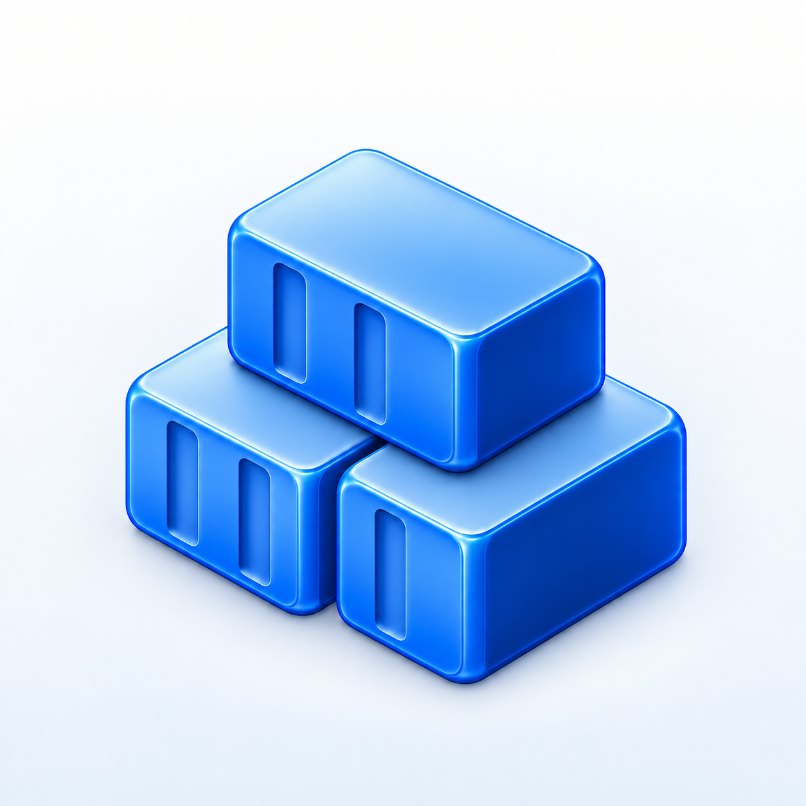
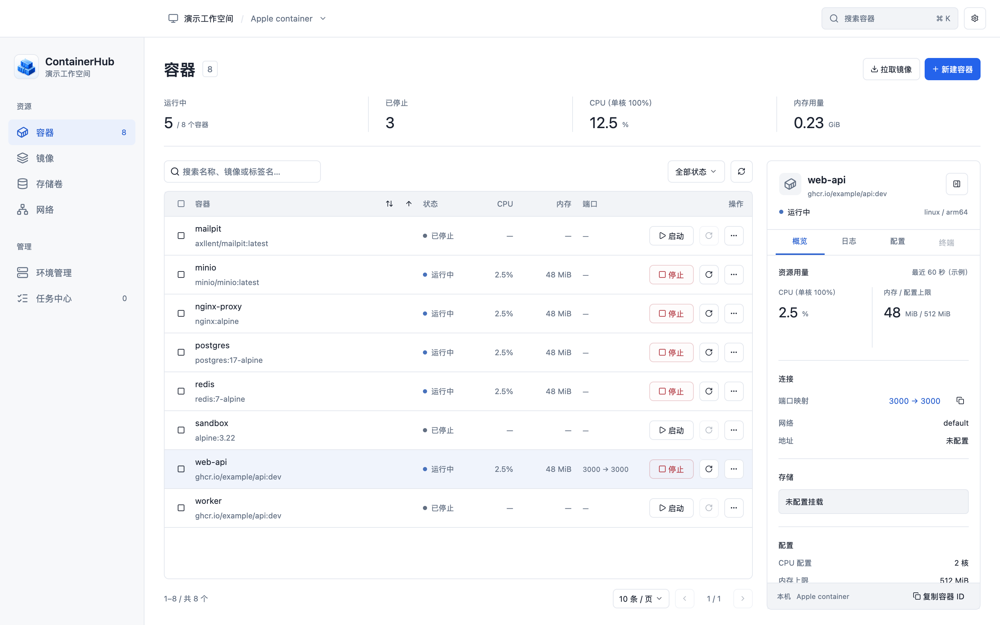

<p align="center"></p>

# ContainerHub

A native macOS workspace for containers, built with Rust and GPUI. Manage local
Apple containers and Docker environments, inspect Compose and Swarm stacks, and
reuse the same management core from a desktop app, Agent or Node.js process.

[简体中文](README.zh-CN.md) · [Architecture](docs/ARCHITECTURE.md) · [Node SDK](packages/node/README.md) · [Contributing](CONTRIBUTING.md)

**Early development.** The desktop interface is currently in Simplified Chinese.
There are no signed/notarized releases or published npm packages yet. Kubernetes,
a complete Web client and production remote enrollment are still in development.

<picture>
  <source media="(prefers-color-scheme: dark)" srcset="docs/images/containers-dark.png">
  
</picture>

*Actual GPUI/Metal rendering with isolated sample data; not a live host screenshot.*

## What works

- Container lists, search, stable sorting, pagination and batch lifecycle actions.
- Container inspection, logs, resource sampling and advanced creation on supported
  providers. Apple port changes use an explicit destructive rebuild confirmation.
- Image selection and management, volume/network inventory, environment editing
  and persistent operation history with failure recovery.
- Docker contexts, Compose project operations and Swarm service management,
  including replica counts and quick container overviews.
- Light/dark themes and layouts that adapt to the available list/inspector width.
- Shared Rust management modules, a Node ESM/TypeScript SDK and an experimental
  encrypted Agent with direct and outbound-relay transports.

Provider capabilities differ:

| Area | Current scope |
| --- | --- |
| Apple container | Read/inspect/logs/stats, image pull/delete, advanced creation, lifecycle and port rebuild. Writes are gated to the adapted CLI 1.6.0 contract. |
| Docker | Inventory, inspection, basic creation and lifecycle; existing Compose and Swarm deployments. Docker logs/stats, image mutation and port rebuild are not implemented. |
| Stacks | Manage existing containers/services. No Compose YAML deployment, `compose up/down`, or Swarm cluster provisioning. |
| Remote | Identity, authorization, encrypted transport and recovery are implemented and tested with isolated local fixtures. Production app attestation/credential issuance and real WAN/NAT acceptance remain incomplete. |
| Web / Kubernetes | Browser protocol module exists. The full Web product, cloud synchronization and Kubernetes adapter are not implemented. |

Running is not the same as healthy. Missing telemetry is shown as unavailable.
See [development notes](docs/DEVELOPMENT.md) and [remote scope](docs/REMOTE-DEVELOPMENT.md)
for validation details and remaining work.

## Run locally

The desktop currently targets **Apple silicon, macOS 26+**. Use Rust **1.99.1+**,
Xcode Command Line Tools and Python 3 for packaging/design scripts. Node **22+**
is needed only for the SDK and its tests. Runtime CLIs are installed separately.

```sh
git clone https://github.com/backrunner/containerhub.git
cd containerhub

# Sample data only; does not operate a container runtime.
cargo run -p containerhub --locked -- --demo

# Connect to the current user's Apple container runtime.
cargo run -p containerhub --locked
```

Add an existing Docker context through environment management. The app does not
install or upgrade runtimes. Unknown Apple CLI versions retain verified read
capabilities; unverified write operations stay disabled.

```sh
python3 scripts/package-dev.py   # dist/ContainerHub.app; local ad-hoc-signed build
python3 scripts/package-node.py  # dist/node; SDK plus this platform's Rust bridge
```

For Agent setup and browser protocol builds, follow
[REMOTE-DEVELOPMENT.md](docs/REMOTE-DEVELOPMENT.md). Development credentials are
loopback-only fixtures and cannot establish production trust.

## Develop and verify

```sh
cargo fmt --all -- --check
cargo clippy --workspace --all-targets --all-features --locked -- -D warnings
cargo test --workspace --all-features --locked

cargo build -p containerhub-bridge --locked
node tests/node-management.mjs
node tests/node-sdk-failures.mjs

# Actual native components, isolated data; requires a macOS graphical session.
cargo run -p containerhub --features ui-validation --locked -- --validate-ui
```

The UI suite checks light/dark themes at 760×560, 1040×700 and 1440×900. Add
`--structure-only` to skip Metal image capture. Logs, profiles and generated
artifacts belong in the ignored `.local/`, `target/` and `dist/` directories.

| Directory | Responsibility |
| --- | --- |
| `crates/core`, `host`, `management` | Resource contracts, telemetry, queues, persistence and recovery |
| `crates/providers`, `runtime` | Apple/Docker adapters and shared runtime composition |
| `crates/remote`, `apps/agent` | Identity, encrypted RPC, Agent and relay |
| `apps/desktop`, `apps/bridge` | GPUI desktop and typed stdio bridge |
| `packages/node`, `client-js` | Node SDK and browser protocol client |
| `.agents/`, `docs/` | Plans, runnable design prototype, architecture and development records |

Preview the design with `python3 -m http.server 8765 --bind 127.0.0.1 --directory .agents`,
then open `http://127.0.0.1:8765/design/`. Prototype actions only change sample data.

## License

ContainerHub's original work is licensed under [Apache-2.0](LICENSE).
Dependencies and copied icons retain their own terms; see
[third-party notices](THIRD_PARTY_NOTICES.md) and the
[dependency inventory](docs/DEPENDENCIES.md).

See [CONTRIBUTING.md](CONTRIBUTING.md) for changes and [SECURITY.md](SECURITY.md)
for private vulnerability reports. ContainerHub is an independent project and
is not affiliated with Apple or Docker.
