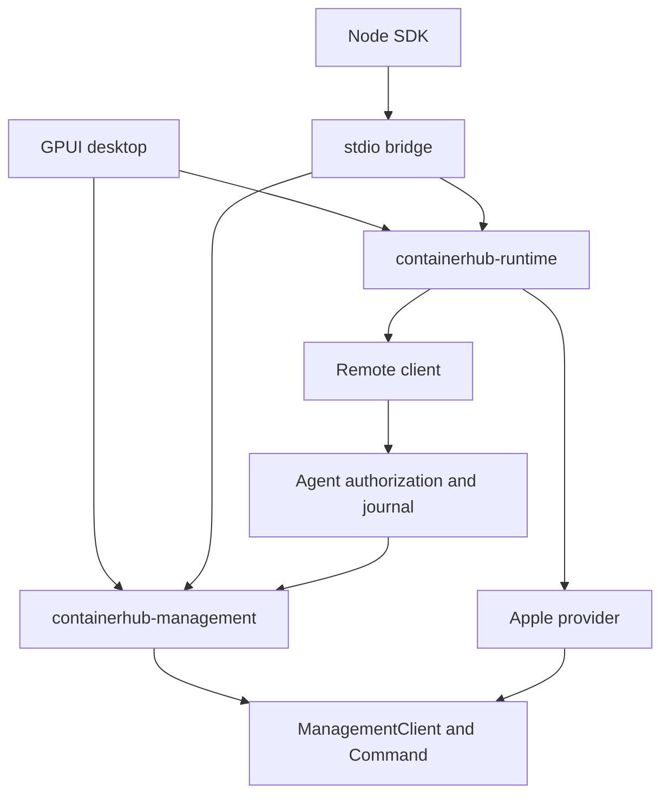

# 公共管理模块与接入方式

2026-10-23，开发增量 19。桌面、Agent 和 Node 共用 Rust 命令契约与执行逻辑；UI、传输、凭据和运行时适配各自独立。实际 provider 包含 Apple container 与 Docker CLI，另有显式 FakeProvider；Kubernetes 仍只有模型预留。Docker 的 Compose/Swarm 契约及验收边界见 [INCREMENT-19.md](INCREMENT-19.md)。拉取控制、创建选项和脱敏检查见 [INCREMENT-6.md](INCREMENT-6.md)。

## 模块职责

| 模块 | 公共职责 | 依赖边界 |
| --- | --- | --- |
| `containerhub-core` | ResourceKey、Command、CreateContainer、Operation、Stats、能力与错误；ManagementClient 接口 | 不依赖 GPUI、具体运行时或网络；旧生命周期日志兼容在这里 |
| `containerhub-management` | 命令校验/执行、持久化队列、同资源串行、并发限制、恢复核对、操作查询服务 | 只依赖 core 等基础库；不依赖 Apple、remote 或 UI |
| `containerhub-apple` | CLI 路径/版本、结构化解析、资源查询、变更、统计采样、进程限制 | core 的 provider；不负责界面、用户授权或远程身份 |
| `containerhub-remote` | 设备身份、签名授权、加密传输、Agent pin、绑定与远程操作日志 | Native 使用 management；浏览器/WASM 构建不包含本机执行服务 |
| `containerhub-runtime` | 组合 Apple、Demo、远程客户端，提供稳定存储 ID 与 profile 实例锁 | 面向原生宿主；不含 GPUI，不是浏览器模块 |
| `apps/desktop` | GPUI 界面、输入、选择、刷新与事件适配 | 使用 runtime 和 management，无独立 CLI 写命令 |
| `apps/agent` | Agent/Relay 进程与身份管理 CLI | 服务端每次检查授权，再执行公共 Command；SQLite 保存远程受理证据 |
| `apps/bridge` | 有界 JSON stdio 服务 | runtime + OperationService，无监听端口、无任意 shell 接口 |
| `packages/node` | ESM SDK、TypeScript 类型、子进程与请求关联 | 不实现容器管理逻辑，不读取或导出私钥 |



桌面原来的大文件已按启动、导航、列表、详情、表单、任务、日志、统计和操作拆分。Apple 的变更、统计、进程与解析分开；remote 的凭据、文件存储和操作记录也独立。core 新增 execution/create_options/inspect，Apple inspect 和桌面检查/高级表单独立，Agent 操作协调拆到 server/operations。增量 7 将运行时能力契约与排序放入 core 的 discovery/inventory，CLI 探测放入 Apple discovery，桌面诊断设置与日志选区各自独立。模块按职责拆分，新增 provider 不需要复制桌面或 Node 的任务逻辑。

## 共享操作与恢复

`Command` 是带 `kind` 的枚举：`lifecycle`、`pull_image`、`create_container`、`delete_container`、`delete_image`。读取使用 `diagnostics/snapshot/resources/inspect_container/inspect_image/logs/stats`；变更通过 `execute_controlled` 共享阶段进度与取消控制，`execute` 保留无控制入口；一次性秘密输入放在 `ExecutionControl`，不会放进持久化 Command/Operation。详见 [INCREMENT-9.md](INCREMENT-9.md)。容器资源键包含 environment、provider、namespace、id、incarnation；镜像键包含 environment、provider、reference、digest。UI、SDK 和 Agent 均传递完整键，拒绝已被替换的目标。

本机/Node 队列先保存 Queued 再受理，最多排队 32 项、同时执行 4 项，同环境的同容器名称串行。入站通道另有 32 个尚未受理请求的上限。Agent 使用公共 scheduler，保留其带 owner/device/Agent 身份的 SQLite 事务与请求去重。两类日志不能直接合并：本机 JSON 服务不承担远程身份校验。

任务列表显示最近 100 条，去重记录保留至 100000 条，达到上限拒绝新请求；不会为节省空间静默忘记已经执行的 ID。维护/归档工具仍待实现。直接使用公共 OperationService 的宿主负责持有存储目录实例锁；desktop 和 bridge 已这样做。不同宿主各自的队列不是跨进程全局互斥；运行时仍可能被外部 CLI 修改，provider 在执行前后核验资源身份和状态。

重启后不自动重放 Queued、创建、拉取、删除或重启。运行中 Start/Stop 仅在相同 incarnation 的实际状态一致时确认成功；其余未完成任务保留 UnknownOutcome。旧 `{key,action}` 日志/远程请求仍可读，新的格式统一为 `command`；同时携带两套字段会被拒绝。

CLI 写超时、网络中断或强制关闭 bridge 不等于底层操作取消。保留原 operation ID，先查询任务与实际资源，不自动生成新 ID 重做。Node 本机日志与 Agent 请求日志分别持久化；进程在远程操作中途崩溃后，本机可能只能报告 UnknownOutcome，新任务在发送前持久化 ExecutionReceipt，重启/人工核对查询原请求，恢复关联不依赖直连或中继地址。旧无关联日志不能补造请求 ID，Agent 自身中断仍可能无法确认结果。

## Node 接入

当前选择 Rust 子进程 + stdio，可从 Node 或 Electron 主进程使用，不绑定 Node 原生扩展 ABI。SDK 的 [使用说明](../packages/node/README.md) 包含本机、Demo 和远程示例。浏览器仍使用 `packages/client-js` 的 WebCrypto/WASM 协议，不能启动本机子进程。

协议 v1 为逐行 UTF-8 JSON：

```json
{"version":1,"id":"request-uuid","request":{"method":"submit","params":{"operation_id":123,"command":{"kind":"pull_image","environment":"apple:local:current-user","reference":"docker.io/library/nginx:alpine"}}}}
```

示例 environment 必须换成 `snapshot().environment`；不能猜测真实环境 ID。响应包含相同 id，以及 `result` 或 `{kind,message}` error。支持 hello、reconcile、diagnostics、snapshot、resources、inspect_container、inspect_image、logs、export_logs、stats、submit、cancel、operation、operations。export_logs 只返回内容，不接受文件路径。传输请求 id 与持久化 operation_id 不同。

- 每帧最多 1 MiB，最多 32 个并发请求；未知协议版本返回 Unsupported，损坏/超长帧终止连接。
- stdout 只有协议帧，诊断走 stderr。SDK 只缓存末尾 4 KiB 诊断，并为单次 RPC 设置 15 秒期限。
- binary、stateDirectory、remote profile 与可选 appleBinary 必须是绝对路径；子进程不经过 shell。
- EOF 等待已受理任务结束。SDK 默认关闭等待 15 秒，可调长；超时强制结束返回 UnknownOutcome。
- 同一远程 profile 只能被一个 desktop/CLI/bridge 实例占用。JS 只传 profile 路径，Rust 负责 Keychain/设备签名/续期与 Agent pin。

后续如需进程内 Node 接入，可新增 N-API 薄封装调用 `Runtime` 与 `OperationService`，不用迁移 provider 或改写命令；当前没有实现或发布 N-API 包。`@containerhub/node` 目前为 workspace 内部开发包，未上传 npm，也没有自动下载二进制。

## 当前功能边界

基础创建支持名称、已有镜像、CPU/内存和端口。桌面端口支持多组 loopback TCP/UDP 映射；公共契约支持最多 32 组显式 IP 的 TCP/UDP 映射。创建默认停止，可选通过公共持久化流程立即启动。`options` 支持网络、已有命名卷、用户、容器工作目录和只读根文件系统。支持自定义启动程序/参数和独立的一次性秘密环境输入；未开放宿主挂载和自动删除。

删除要求相同 incarnation 且已停止，确认会删除该容器的可写层；不使用 force/all/volumes 参数。Apple CLI 以名称寻址，无法原子地附加 incarnation 条件；执行前后核对能拒绝已有旧键，但不能消除外部 CLI 在核对与写入之间替换同名资源的竞态。拉取有阶段进度与持久化取消；未执行的任务可确认取消，运行中终止客户端后仍需核对后台结果，不保证撤销。没有下载字节百分比。统计采用 Apple 1.6.0 JSON 累积 CPU 时间差与内存用量；CPU 首次没有差值时显示未知，100% 表示一个 CPU 的占用，多核可超过 100%。最多缓存 256 个资源的采样，闲置 60 秒丢弃基线。

字段与 CLI 行为按 Apple 1.6.0 的 [ContainerStats](https://github.com/apple/container/blob/1.6.0/Sources/ContainerCommands/Container/ContainerStats.swift)、[ContainerCreate](https://github.com/apple/container/blob/1.6.0/Sources/ContainerCommands/Container/ContainerCreate.swift) 和 [ImagePull](https://github.com/apple/container/blob/1.6.0/Sources/ContainerCommands/Image/ImagePull.swift) 核对。源码/CLI 模拟验证不能代替真实运行时验收，当前证据见 [DEVELOPMENT.md](DEVELOPMENT.md)。

## 运行时诊断与配置

`RuntimeDiagnostics` 返回 21 项能力、不可用原因、CLI 版本/路径及独立的服务错误。Apple 只读取版本、公共 `--help` 与 `system status`；命令/参数契约缓存 30 秒，文件指纹变化或显式诊断刷新时重新检查，重叠诊断复用一次探测。单个帮助检查最多 2 秒、并发最多 4，输出有界；服务检查最多 3 秒。帮助检查不是执行结果或完整版本兼容承诺，写操作仍需版本白名单和操作前后核对。

未知版本仅开放可验证的读取；高级创建独立于基础创建，不可用功能在 provider 层也拒绝。Agent 的诊断还会按当前设备授权过滤；不能通过 DTO 修改远程 CLI 路径。

桌面本机 CLI 路径在保存前验证文件/执行权限和 Apple 版本，服务离线不阻止保存；下次启动生效。主题/排序的晚到保存不会覆盖已确认路径。Node/Agent 通过本机进程参数配置，路径不经 shell。公共查询仅透出标签名称，值不进入 UI、RPC 或历史。

## 原任务关联与恢复

`Operation.receipt` 可选，旧记录默认 None。RemoteClient 在 `prepare_execution` 生成公开关联；management 写入 Running 和 receipt 成功后调用 `execute_prepared`。`resume_execution` 只查询原请求并返回明确终态；查询错误与明确执行失败分开，前者保留 UnknownOutcome。

公共队列将恢复查询放到 Ready 之后调度，最多自动排入 32 项，并复用 4 项并发及同资源锁。`OperationService::reconcile` 与 Node/desktop 入口共用队列；恢复、取消控制与执行各自拆为小模块。取消已在 Agent 执行的请求必须按原 ID 核对，不能因本地核对尚未开始而报 Cancelled。详细边界见 [INCREMENT-8.md](INCREMENT-8.md)。

## 启动配置

可选 `CreateOptions.startup` 使用 core/startup 的 `StartupCommand`：entrypoint 与有序 arguments，缺省保留镜像配置，普通参数进入任务记录；秘密值继续走独立输入通道。Apple 创建逻辑拆入 `providers/apple/create`，desktop 表单拆入 `forms/startup`。Node 与 Agent 沿用 Command，不增加本机 shell 入口。`create_startup`/`startup_command` 独立探测并按 ManageContainers 过滤。语义与证据见 [INCREMENT-10.md](INCREMENT-10.md)。

## 创建后启动与检查点

`core/workflow` 编排创建、保存身份、启动及状态核对；`ExecutionControl` 持有不含秘密值的创建结果和异步 `CreationCheckpoint`。management/queue/checkpoint 写入 JSON 后 ACK，remote/server/checkpoint 写入 SQLite 后再核对当前授权。创建确认而保存失败时不继续启动。provider 只执行单步操作，直接给 provider 传 start_after_create 会被拒绝；宿主须使用 OperationService，不能绕开持久化。

远程 receipt 存在时整项命令交给 Agent，不在控制端另起创建/启动。Agent 任务查询和本机 Operation.result 在 Failed/UnknownOutcome 时仍可保留 Container；只有 Succeeded 表示已确认运行。恢复查询不清除已知身份，重试只构造同一 incarnation 的 Start；缺失或替换的对象不自动重建。独立 create_and_start 能力缺省 false，旧端不会被推断为支持。详细语义见 [INCREMENT-11.md](INCREMENT-11.md)。

### 本机运行时启动

`Command::StartRuntime` 只接受 environment；能力从 `RuntimeDiagnostics` 获取，因此没有 inventory 也能提交。Apple `system` 模块使用固定无交互命令，序列化启动并查询服务后置状态。management 的恢复和核对调用 diagnostics，不重放启动；桌面和 Node 复用这条路径。远程 client 和 Agent 双向拒绝此动作，现有 Lifecycle grant 不包含主机服务管理权限。详见 [增量 17](INCREMENT-17.md)。


## Stack contracts

`core/stacks` groups Compose members and Swarm services, keyed by environment + kind + name. `core/swarm` defines manager state, immutable service identity/version, task inventory and typed scale/restart/remove actions. `providers/docker` owns process bounds, redaction, inventory parsing and mutation postconditions; Swarm reading and writing live in separate modules. Runtime selection (`Runtime::docker`), desktop, Agent and Node all reuse this provider.

Native Stack list, Compose details, confirmations, Swarm details and replica form are split into small modules. No Compose label points the host at a config file to execute. Swarm service changes enter the same persistent per-resource scheduler, use a distinct service lock namespace, and require both ManageContainers and Lifecycle on the remote Agent. Node adds inventory and plan APIs while submitting normal typed commands. Recovery never replays a service mutation whose outcome is unknown.
